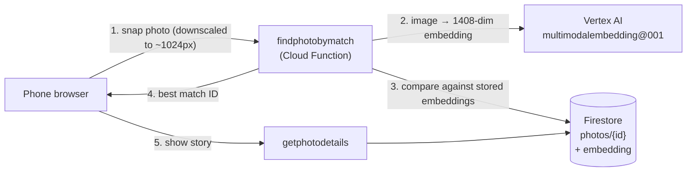

# Gallery

**Point your phone at a framed photo on the wall and Gallery tells you its story.**

Gallery is an AI-enabled digital scrapbook for physical photos. Scan a print hanging in your home, and Gallery visually matches it to an entry in your collection and shows who's in it, when it was taken, and the stories that go with it, along with links to related photos.

Live example: <https://gallery-469818.web.app/>

---

## How it works



1. The browser downsizes the camera image and sends it to the `findphotobymatch` callable function.
2. The function gets an image embedding from Vertex AI's `multimodalembedding@001` model.
3. It compares that vector (dot product) against the embedding **stored on every photo's Firestore document** and picks the most similar one above a threshold.
4. The browser navigates to that photo's page.

When an editor adds a photo, `addphoto` computes its embedding once and saves it on the document.

### Why there's no vector database
An earlier version used a Vertex AI Vector Search index endpoint. Those endpoints bill **around the clock** whether or not anyone is scanning, which came to nearly \$1,000 in the first month. For a household-sized collection (tens to hundreds of photos), a brute-force in-memory comparison takes milliseconds, so Gallery stores embeddings next to the data and only pays while a function is actually running.

> [!IMPORTANT]
> Keep it that way. Don't add Vector Search endpoints, `min_instances`, VMs, or anything else that runs when nobody is using the app.

### Expected cost
| Usage | Approximate monthly cost |
|---|---|
| Idle | ~\$0.05 (storage for photos and function images) |
| Light family use | well under \$1 |

Safeguards built into this repo:
- Every function scales to zero and has a `max_instances` cap (2–3).
- Lightweight functions run with 512 MB; only the two that call Vertex AI get 1 GB.
- The Vertex AI SDK is imported lazily, so the Firestore-only functions cold-start fast.
- Scans are downsized in the browser before upload.

---

## Tech stack

| Layer | Technology |
|---|---|
| Frontend | Static HTML, vanilla JS, Bootstrap 3, served by **Firebase Hosting** |
| Auth | **Firebase Authentication** (Google sign-in) plus an `editor` custom claim |
| API | **Cloud Functions for Firebase** (2nd gen, Python 3.12, callable functions) |
| Data | **Cloud Firestore** (photo metadata and embeddings) and **Cloud Storage for Firebase** (images) |
| AI | **Vertex AI** multimodal embeddings (`multimodalembedding@001`) |

### Security model
- **Anyone** can view photos and scan. This is meant for guests in your home.
- Only users with the Firebase Auth custom claim `editor: true` can add, edit or delete photos. This is enforced in the Cloud Functions *and* in the Cloud Storage rules; the UI only uses it to show or hide buttons.
- Firestore rules deny **all** direct client access. The callable functions (Admin SDK) are the only data path, and they validate every input.
- The web pages ship with a strict Content-Security-Policy, anti-clickjacking headers, and a Subresource Integrity hash on the Bootstrap CDN link. User content is always rendered with `textContent`, never `innerHTML`.

> [!NOTE]
> The Firebase web config (including `apiKey`) is served publicly by Hosting at `/__/firebase/init.js`. That's by design: Firebase web API keys identify the project; they don't authorize access. Access control comes from the rules and function checks above. For defense in depth, restrict the browser key to your Hosting domains in the Cloud console (see step 9).

---

## Repository layout

```
├── firebase.json            # Hosting (incl. security headers), Functions, rules config
├── firestore.rules          # Deny-all: clients never touch Firestore directly
├── storage.rules            # Public read; editor-only, image-only, 15 MB uploads
├── functions/
│   ├── main.py              # All Cloud Functions
│   └── requirements.txt
├── public/                  # Static site served by Firebase Hosting
│   ├── common.js            # Shared helpers: safe DOM building, auth nav, scanning
│   ├── photo-form.js        # Shared "related photos" editor for add/edit pages
│   ├── index.html / app.js  # Home page with "Scan Photo"
│   ├── photos.html / .js    # Full photo list (+ edit/delete for editors)
│   ├── view-photo.html/.js  # A photo's story and related photos
│   ├── add-photo.html/.js   # Editors: upload a new photo
│   └── edit-photo.html/.js  # Editors: edit a photo's details
└── scripts/
    ├── set_editor.py        # Grant/revoke/list editor access
    └── add_embeddings.py    # Backfill embeddings for existing photos
```

### Data model
`photos/{photoId}`:

| Field | Type | Notes |
|---|---|---|
| `name` | string | Required; shown as the title |
| `date` | string | Free text, e.g. `"Summer 1952"` |
| `description` | string | The story; line breaks are preserved |
| `relatedPhotos` | array of `{id, text}` | Links to other photos, e.g. `{id: "abc", text: "her sister"}` |
| `imageUrl` | string | Firebase Storage download URL |
| `embedding` | array of 1408 numbers | Set server-side; never sent to the browser |
| `uploaderUid` | string | Set server-side |

---

## Set up your own Gallery

These steps deploy a complete, independent copy of Gallery into **your own** Google Cloud / Firebase project.

### Prerequisites
- A Google account and a billing account. Cloud Functions and Vertex AI require the Firebase **Blaze** (pay-as-you-go) plan, though expected costs are only cents.
- [Node.js](https://nodejs.org/) 20+ and the Firebase CLI: `npm install -g firebase-tools`
- The [Google Cloud CLI](https://cloud.google.com/sdk/docs/install) (`gcloud`)
- Python **3.12**

### 1. Create the project
1. In the [Firebase console](https://console.firebase.google.com/), click **Add project**. Analytics is optional and not used.
2. Upgrade the project to the **Blaze** plan.
3. **Set a budget alert first.** In the Cloud console, open **Billing → Budgets & alerts** and create a budget (e.g. \$5/month, alerts at 50/90/100%). Or use the CLI:
   ```bash
   gcloud billing budgets create --billing-account=YOUR_BILLING_ACCOUNT_ID \
     --display-name="Gallery" --budget-amount=5USD \
     --filter-projects=projects/YOUR_PROJECT_ID \
     --threshold-rule=percent=0.5 --threshold-rule=percent=0.9 --threshold-rule=percent=1.0
   ```

### 2. Enable the Firebase products
In the Firebase console for your project:
1. **Authentication → Sign-in method:** enable **Google**.
2. **Firestore Database:** create a database in **Native mode**, location `us-central1`.
3. **Storage:** create the default bucket, location `us-central1`.
4. **Project settings → General → Your apps:** add a **Web app** and check **Also set up Firebase Hosting**. You don't need to copy the config snippet; Hosting serves it automatically at `/__/firebase/init.js`.

### 3. Enable the Google Cloud APIs
```bash
gcloud config set project YOUR_PROJECT_ID
gcloud services enable aiplatform.googleapis.com cloudfunctions.googleapis.com \
  cloudbuild.googleapis.com artifactregistry.googleapis.com run.googleapis.com
```

### 4. Allow the functions to call Vertex AI
Cloud Functions (2nd gen) run as the Compute Engine default service account. Give it the Vertex AI User role:
```bash
PROJECT_NUMBER=$(gcloud projects describe YOUR_PROJECT_ID --format='value(projectNumber)')
gcloud projects add-iam-policy-binding YOUR_PROJECT_ID \
  --member="serviceAccount:${PROJECT_NUMBER}-compute@developer.gserviceaccount.com" \
  --role="roles/aiplatform.user"
```

### 5. Get the code and point it at your project
```bash
git clone https://github.com/Chr1st1anSears/gallery.git
cd gallery
firebase login
firebase use --add YOUR_PROJECT_ID   # choose alias "default"
```
`.firebaserc` now points at your project. No project ID is hard-coded anywhere else.

> [!TIP]
> Everything deploys to `us-central1`. To use another region, change `REGION` in `functions/main.py` and pick the same location for Firestore and Storage.

### 6. Install the function dependencies
The Firebase CLI analyzes Python functions using a virtual environment named `venv` inside `functions/`:
```bash
cd functions
python3.12 -m venv venv
source venv/bin/activate
pip install -r requirements.txt
deactivate
cd ..
```

### 7. Deploy
```bash
firebase deploy
```
This deploys Hosting, the Cloud Functions, and the Firestore and Storage rules. Then set a cleanup policy so old function build images don't pile up storage costs:
```bash
firebase functions:artifacts:setpolicy --days 1 --force
```
Your site is now live at `https://YOUR_PROJECT_ID.web.app`.

### 8. Make yourself an editor
1. Open your site and click **Login** once, so your account exists.
2. Grant editor access with Application Default Credentials:
   ```bash
   gcloud auth application-default login
   pip install firebase-admin     # or reuse functions/venv
   GOOGLE_CLOUD_QUOTA_PROJECT=YOUR_PROJECT_ID \
     python scripts/set_editor.py --project YOUR_PROJECT_ID you@example.com
   ```
   (`GOOGLE_CLOUD_QUOTA_PROJECT` tells the Auth admin API which project to attribute the call to, without changing your global ADC settings.)
3. Log out and back in on the site. You'll now see **Add Photo**, **Edit** and **Delete**.

Use `--list` to see editors and `--revoke` to remove one.

### 9. (Recommended) Restrict the browser API key
In the Cloud console, go to **APIs & Services → Credentials → Browser key (auto created by Firebase)** and add **Website restrictions** for your domains:
```
https://YOUR_PROJECT_ID.web.app/*
https://YOUR_PROJECT_ID.firebaseapp.com/*
http://localhost/*
```

### 10. Add your photos
On the **Photos** page, click **Add Photo**, then upload a clear, straight-on image of each print, give it a name, date and story, and link related photos. Embeddings are generated automatically.

> [!TIP]
> For the best scan accuracy, upload a photo of the *framed print as it hangs* (taken with a phone) rather than an original high-res scan. That way the stored image looks like what guests will capture.

If you import photos some other way (e.g. writing Firestore documents directly), backfill their embeddings:
```bash
GOOGLE_CLOUD_QUOTA_PROJECT=YOUR_PROJECT_ID \
  python scripts/add_embeddings.py --project YOUR_PROJECT_ID
```
(requires `pip install firebase-admin google-cloud-aiplatform`)

---

## Day-to-day development

| Task | Command |
|---|---|
| Preview a frontend change on a temporary URL | `firebase hosting:channel:deploy preview --expires 1d` |
| Deploy only the frontend | `firebase deploy --only hosting` |
| Deploy only the functions | `firebase deploy --only functions` |
| Deploy only the rules | `firebase deploy --only firestore:rules,storage` |
| Read function logs | `firebase functions:log` or Cloud console → Logging |

> [!NOTE]
> Preview channels use the production backend, so viewing and scanning work there. **Google sign-in does not**, unless you add the channel's domain to **Authentication → Settings → Authorized domains** and to the browser API key's website restrictions. Test editor flows locally or on the live site.

Tuning knobs at the top of `functions/main.py`:
- `SIMILARITY_THRESHOLD` (default `0.6`): raise it if scans return wrong matches; lower it if good scans come back "no match".
- `MAX_INSTANCES_PUBLIC` / `MAX_INSTANCES_EDITOR`: hard caps on concurrent instances.

## Troubleshooting

| Symptom | Likely cause |
|---|---|
| "Error loading photos" on every page; logs say *billing is disabled* | The project's billing account is closed, or its card expired or was replaced. Re-link billing in the Cloud console. |
| Scans always fail with an internal error | The functions' service account lacks `roles/aiplatform.user` (step 4), or the Vertex AI API isn't enabled (step 3). |
| Signed in but no Add/Edit buttons | You don't have the `editor` claim yet (step 8), or you need to log out and back in. |
| Upload fails with a permission error | Same as above (Storage rules require the `editor` claim), or the image is over 15 MB. |
| `identitytoolkit.googleapis.com API requires a quota project` when running scripts | Prefix the command with `GOOGLE_CLOUD_QUOTA_PROJECT=YOUR_PROJECT_ID`. |
